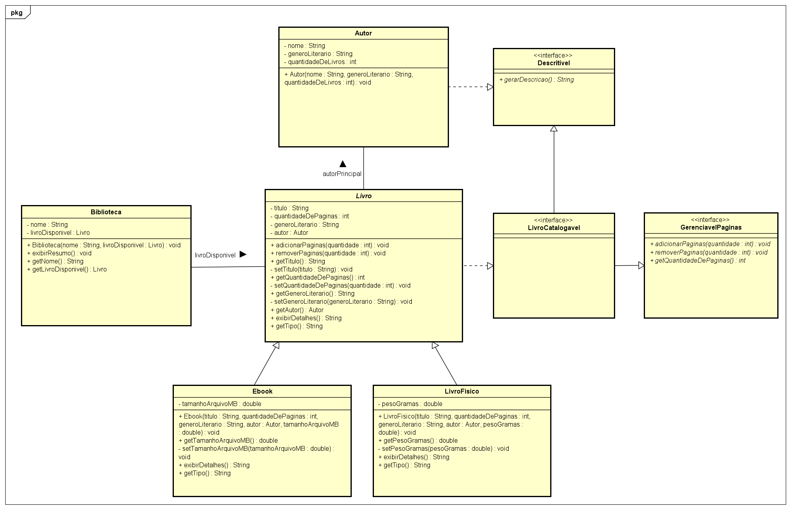

# Projeto FiapRide - Ernandes Da Silva Jesus

## Informações do Aluno

- **Nome:** Ernandes Da Silva Jesus
- **RM:** 566611
- **Turma:** CCPB
- **Curso:** Ciência da Computação
- **GitHub:** [@ernandes-dev](https://github.com/ernandes-dev)

---

## Descrição do Projeto

Este projeto reúne os exercícios de Programação Orientada a Objetos desenvolvidos nas aulas 1 a 9, utilizando Java para praticar classes, objetos, métodos, encapsulamento, construtores, associação, herança, polimorfismo, classes abstratas e interfaces.

O projeto pessoal utiliza o domínio de livros e biblioteca. As classes `Autor`, `Biblioteca`, `Livro`, `Ebook` e `LivroFisico` representam os elementos desse domínio. As interfaces `Descritivel`, `GerenciavelPaginas` e `LivroCatalogavel` demonstram contratos de comportamento e polimorfismo por interface.

Os exemplos e testes estão organizados nos pacotes `br.com.fiapride.model` e `br.com.fiapride.main`. A modelagem das classes e de seus relacionamentos é realizada por meio de diagramas UML no Astah.

---

## Checklist de Implementação

- [x] Aula 1 - Classes e Objetos
- [x] Aula 2 - Métodos
- [x] Aula 3 - Encapsulamento
- [x] Aula 4 - Construtores&#x20;
- [x] Aula 5 - Associação
- [x] Aula 6 - Herança
- [x] Aula 7 - Polimorfismo
- [x] Aula 8 - Classes Abstratas
- [x] Aula 9 - Interfaces&#x20;

---

## Perguntas de Reflexão

### Aula 1 - Classes e Objetos

**Pergunta:** Por que precisamos criar uma classe `Passageiro`? Não seria mais fácil apenas criar variáveis soltas no `main`, como `String nomeAna = "Ana"` e `double saldoAna = 50.0`?

**Pense:** E se o FiapRide tiver um milhão de usuários? Como a classe ajuda a resolver isso?

**Sua Resposta:**

A classe `Passageiro` funciona como um molde que reúne as informações e os comportamentos de cada passageiro, como nome e saldo. Em vez de criar variáveis separadas para cada pessoa, podemos instanciar objetos que seguem a mesma estrutura. Se o FiapRide tivesse um milhão de usuários, seria muito difícil organizar todos os dados usando variáveis soltas no `main`. Com as classes, podemos criar objetos e organizá-los em coleções, facilitando o acesso, a manutenção e o processamento dos dados. A classe não economiza memória automaticamente, mas ajuda a organizar o sistema e evitar a repetição de código.

---

### Aula 2 - Métodos

**Pergunta:** Se nós podemos simplesmente fazer `passageiro.saldo = passageiro.saldo + 100` diretamente no código principal, por que dá tanto trabalho criar um método específico chamado `adicionarSaldo(valor)` para fazer isso? Quais seriam os riscos para a nossa startup de mobilidade se deixássemos qualquer programador alterar o saldo diretamente?

**Sua Resposta:**

Criamos um método como `adicionarSaldo(valor)` porque não queremos permitir que qualquer parte do sistema altere o saldo sem seguir as regras de negócio. Dentro do método, podemos validar o valor recebido e impedir operações inválidas. Se cada programador pudesse alterar o saldo diretamente, poderíamos ter valores incorretos, saldos negativos ou alterações sem autorização. Centralizar essa operação em um método torna o comportamento mais controlado, previsível e fácil de manter. No meu projeto, aplico uma ideia semelhante nos métodos `adicionarPaginas()` e `removerPaginas()` da classe `Livro`, que validam as quantidades antes de modificar o estado do objeto.

---

### Aula 3 - Encapsulamento

**Pergunta:** No nosso código, os atributos são `private`, mas os métodos `getSaldo()` e `getNome()` são `public`. Por que é seguro deixar o `get` público, mas perigoso deixar o atributo original público?

**Pense:** Qual a diferença entre dar a alguém uma cópia de um documento seu e entregar o documento original para a pessoa rasurar?

**Sua Resposta:**

Os atributos são `private` para impedir que outras classes os acessem ou alterem diretamente. Já os getters são `public` porque permitem consultar informações de maneira controlada, sem dar acesso direto ao atributo original. Um getter permite ler um valor, enquanto um método que modifica o estado precisa respeitar as regras definidas pela classe. A diferença é semelhante à de fornecer uma cópia de um documento para consulta e entregar o documento original para alguém alterar. No meu projeto, os atributos de `Livro` são privados, e os métodos públicos permitem consultar informações e executar operações sem expor diretamente os dados internos.

---

### Aula 4 - Construtores

**Pergunta:** Na nossa classe `Veiculo`, nós tomamos duas decisões arquitetônicas importantes:

1. Nós **não** criamos o método `setModelo()`.
2. O `setPlaca()` foi criado como **privado**, e criamos um método público chamado `atualizarPlaca()` para acessá-lo.

Pensando no mundo real e no Clean Code: por que é um erro gerar getters e setters para tudo automaticamente na IDE? Como as duas decisões acima protegem o sistema de fraudes e falhas de lógica?

**Dica:** Pense sobre o que pode ou não mudar fisicamente em um carro e a diferença entre alterar um dado no banco e executar um processo real no Detran.

**Sua Resposta:**

É um erro gerar getters e setters para todos os atributos automaticamente porque a IDE não conhece as regras de negócio do sistema. Cada atributo deve ter apenas os métodos de acesso necessários, evitando alterações que possam deixar o objeto em um estado inválido. No exemplo da classe `Veiculo`, não criar `setModelo()` impede que o modelo seja alterado livremente após a inicialização. Já o `setPlaca()` privado permite que a alteração da placa seja controlada por um método público específico, como `atualizarPlaca()`, que pode validar as condições da operação. Dessa forma, o sistema não trata uma mudança importante como uma simples atribuição de variável, ajudando a prevenir inconsistências, falhas de lógica e alterações indevidas.

---

### Aula 5 - Associação

**Pergunta:** No construtor da `Viagem`, nós exigimos o objeto inteiro (`Passageiro solicitante`). Se o nosso resumo só precisa imprimir o nome da pessoa, não seria mais fácil e mais leve pedir apenas uma `String` com o nome do passageiro (`String nomeDoPassageiro`) em vez do objeto todo?

**Pense:** O que acontece quando a viagem acaba e o sistema precisa descontar o saldo? Se a `Viagem` tiver apenas a `String` `"Ana Silva"`, ela consegue mexer no dinheiro dessa pessoa?

**Sua Resposta:**

Utilizar o objeto `Passageiro` no construtor de `Viagem` é mais adequado porque a viagem precisa ter acesso não apenas ao nome, mas também às informações e aos comportamentos daquele passageiro. Se armazenássemos somente uma `String` com o nome, poderíamos exibir quem solicitou a viagem, mas não teríamos uma referência ao objeto responsável pelo saldo e pelos métodos de negócio. Quando a viagem terminasse, precisaríamos acessar o passageiro correto para realizar o pagamento. Além disso, duas pessoas podem ter o mesmo nome, então o nome sozinho não é suficiente para representar a associação. No meu projeto, aplico esse conceito quando `Livro` mantém uma referência a `Autor`, permitindo acessar as informações do autor associado ao livro.

---

### Aula 6 - Herança

**Pergunta:** Na nossa classe mãe `Veiculo`, os atributos `placa` e `modelo` são `private`. Quando `Carro` herda de `Veiculo`, ele recebe esses atributos, mas o código dentro de `Carro` não consegue fazer `this.placa = "ABC"`. Ele é obrigado a usar `super()` ou um método de acesso apropriado.

Por que o Java não deixa a classe filha alterar as variáveis privadas da classe mãe diretamente? Qual princípio das aulas passadas isso está protegendo?

**Sua Resposta:**

O Java não permite que a classe filha acesse diretamente os atributos `private` da classe mãe porque isso protege o encapsulamento. Embora `Carro` herde de `Veiculo`, o acesso direto aos atributos privados continua restrito à classe que os declarou. A classe filha deve utilizar o construtor da classe mãe por meio de `super()` ou os métodos de acesso disponibilizados, respeitando as regras definidas na superclasse. Isso permite que a classe mãe controle como seus dados são inicializados e modificados. No meu projeto, `Ebook` e `LivroFisico` utilizam `super(...)` para inicializar os atributos herdados de `Livro`, sem precisar acessar seus atributos privados diretamente.

---

### Aula 7 - Polimorfismo

**Pergunta:** No nosso loop `for (Veiculo veiculo : frota)`, a variável `veiculo` é do tipo genérico `Veiculo`. Se esquecêssemos de criar o método `calcularAutonomia()` na classe mãe `Veiculo`, conseguiríamos chamá-lo dentro do loop, mesmo sabendo que ele existe nas classes `Carro` e `Moto`? Por que o contrato precisa existir na base da hierarquia?

**Sua Resposta:**

Não conseguiríamos chamar `calcularAutonomia()` por meio de uma referência do tipo `Veiculo` se esse método não estivesse declarado na classe mãe, mesmo que existisse nas classes `Carro` e `Moto`. O compilador verifica os métodos disponíveis no tipo da referência, e não apenas os métodos que existem no objeto concreto. Por isso, o comportamento comum precisa estar declarado na base da hierarquia, podendo ser implementado ou sobrescrito pelas classes filhas. Assim, podemos percorrer uma coleção de `Veiculo` e chamar o mesmo método, deixando o Java executar a implementação correspondente ao objeto real. No meu projeto, utilizo esse conceito quando percorro uma `List<Livro>` e chamo `exibirDetalhes()`, recebendo informações específicas de `Ebook` ou `LivroFisico`.

---

### Aula 8 - Classes Abstratas

**Pergunta:** Pense no mundo real: faz sentido existir um objeto que é apenas um “Veículo”, sem ser um tipo específico? Você já entrou em uma concessionária e comprou um “veículo” genérico, sem ser carro, moto, caminhão ou outra categoria?

Por que, então, no código, precisamos dizer explicitamente ao Java que `Veiculo` é `abstract`? Por que ele não deduz isso sozinho?

**Pense:** Se esquecermos de colocar `abstract`, qual o risco? Alguém poderia criar `new Veiculo()` e comprometer a lógica do sistema?

**Sua Resposta:**

No mundo real, um veículo normalmente pertence a uma categoria específica, como carro, moto ou caminhão. No sistema, podemos transformar `Veiculo` em uma classe abstrata para impedir a criação direta de um objeto genérico e exigir que os objetos sejam instanciados a partir de classes concretas. O Java não deduz essa intenção sozinho porque precisa que o programador declare explicitamente as regras e a estrutura do sistema. Se a classe não fosse abstrata e não tivesse outras restrições de compilação, seria possível criar `new Veiculo()`, mesmo que isso não fizesse sentido para o domínio modelado. No meu projeto, transformei `Livro` em uma classe abstrata para representar as características comuns aos livros e impedir que ela fosse instanciada diretamente, enquanto `Ebook` e `LivroFisico` representam tipos concretos.

---

### Aula 9 - Interfaces

**Pergunta:** Por que Java permite herança simples (apenas uma classe mãe), mas múltipla implementação de interfaces (vários contratos)?

**Pense:** Se `CarroEletrico` pudesse herdar de `Veiculo` e de `Bateria` ao mesmo tempo, o que aconteceria se ambas as classes mães tivessem um método chamado `ligar()`?

Como as interfaces ajudam a resolver esse problema?

**Sua Resposta:**

O Java permite que uma classe herde diretamente de apenas uma classe, mas implemente várias interfaces porque a herança de classes envolve a reutilização de estado e implementações, enquanto as interfaces permitem estabelecer contratos de comportamento diferentes. Se `CarroEletrico` pudesse herdar de `Veiculo` e de `Bateria` ao mesmo tempo, poderiam existir conflitos sobre quais atributos e implementações de métodos seriam herdados, principalmente se ambas as classes definissem um método `ligar()` de formas diferentes. No modelo de interfaces estudado nesta aula, elas definem as assinaturas dos métodos que as classes devem implementar, sem exigir que pertençam à mesma hierarquia. Assim, uma classe pode herdar de uma classe mãe e implementar vários contratos. No meu projeto, `Livro` implementa `LivroCatalogavel`, que reúne os contratos `Descritivel` e `GerenciavelPaginas`, enquanto `Autor` implementa `Descritivel` diretamente. Isso permite que objetos diferentes compartilhem comportamentos sem precisar herdar da mesma classe.

---

## Desafios Técnicos Implementados

### Desafio Pessoal (Seu Projeto)

**Qual foi o domínio que você escolheu para seu projeto pessoal?**

Escolhi o domínio de livros e bibliotecas. O projeto permite representar autores, livros digitais e físicos, além de trabalhar com informações de livros e suas operações. A ideia foi utilizar esse domínio para aplicar os conceitos de Programação Orientada a Objetos estudados nas aulas.

**Quais classes você criou?**

As principais classes do projeto são:

- `Autor`: representa os autores e suas informações.
- `Biblioteca`: representa uma biblioteca associada a um livro.
- `Livro`: classe abstrata que reúne os atributos e comportamentos comuns aos livros.
- `Ebook`: representa os livros digitais e armazena o tamanho do arquivo.
- `LivroFisico`: representa os livros físicos e armazena o peso do livro.

Também criei interfaces para organizar os contratos de comportamento:

- `Descritivel`: define o método `gerarDescricao()`.
- `GerenciavelPaginas`: define operações para adicionar, remover e consultar páginas.
- `LivroCatalogavel`: reúne os contratos de descrição e gerenciamento de páginas.

Para executar e verificar o funcionamento do projeto, utilizei as classes `SistemaPrincipal`, `TesteAutor`, `TesteBiblioteca`, `TesteMeuLivro` e `TesteInterfaces`.

**Qual foi o maior desafio técnico que você enfrentou?**

Meu maior desafio técnico foi entender o polimorfismo e como aplicá-lo corretamente no código. No começo, eu entendia a ideia de ter classes diferentes, mas tinha dificuldade para compreender como chamar o mesmo método e obter comportamentos diferentes dependendo do objeto.

Conforme desenvolvi o projeto, comecei a entender melhor esse conceito utilizando a classe abstrata `Livro` e suas subclasses `Ebook` e `LivroFisico`. Ao armazenar objetos diferentes em uma `List<Livro>` e percorrer a lista chamando `exibirDetalhes()`, consegui observar na prática como cada objeto executa sua própria implementação.

Depois, com as interfaces `Descritivel`, `GerenciavelPaginas` e `LivroCatalogavel`, pude praticar outra forma de polimorfismo, tratando objetos por contratos comuns. Os testes no Eclipse ajudaram a visualizar os resultados e identificar erros. Ainda considero o polimorfismo um conceito que exige prática, mas agora compreendo melhor sua utilidade e como ele permite organizar e reutilizar comportamentos no sistema.

---

## Conclusão

**O que você aprendeu nestas 9 aulas?**

Nestas nove aulas, aprendi a construir um projeto Java utilizando os principais conceitos de Programação Orientada a Objetos. Comecei com classes, objetos e métodos e avancei para encapsulamento, construtores, associação, herança, polimorfismo, classes abstratas e interfaces.

Durante o desenvolvimento, percebi que programar não significa apenas fazer o código funcionar, mas também organizar as responsabilidades de cada classe e proteger os dados contra alterações indevidas. No meu projeto, apliquei esses conceitos utilizando livros, autores e bibliotecas, além de criar subclasses e interfaces para representar diferentes comportamentos. Também aprendi a importância de testar as implementações, validar entradas e manter a documentação e o diagrama UML alinhados ao código. Ainda tenho conceitos para aprofundar, mas consigo relacionar melhor a teoria com situações práticas e compreender por que determinadas decisões de estrutura são importantes.

**Qual conceito foi mais difícil de entender?**

O polimorfismo foi o conceito mais difícil para mim, principalmente no início, porque eu não compreendia muito bem como aplicá-lo no código. Tinha dificuldade para entender por que utilizar uma referência de uma classe mais genérica quando o objeto pertencia a uma classe específica, e como isso permitia executar comportamentos diferentes.

Consegui compreender melhor ao praticar com `Livro`, `Ebook` e `LivroFisico`, utilizando uma lista do tipo `Livro` e chamando o método `exibirDetalhes()`. Percebi que não precisava verificar manualmente o tipo de cada objeto para obter sua descrição específica. Posteriormente, os testes com interfaces também ajudaram a ampliar minha compreensão. Esse processo mostrou que estudar a teoria é importante, mas praticar, executar o código e observar os resultados é fundamental para consolidar o aprendizado.

**O que você melhoraria no seu projeto se pudesse refazer?**

Eu expandiria o sistema de biblioteca para permitir armazenar e gerenciar mais livros, com funcionalidades para cadastrar, consultar, adicionar e remover livros do catálogo. Também implementaria pesquisas por título, autor e gênero literário, além de desenvolver uma forma de persistir os dados em um banco de dados, evitando que todas as informações fossem perdidas quando o programa fosse encerrado. O sistema poderia evoluir para gerenciar tanto o acervo físico quanto o digital, com informações específicas para cada formato.

Outra decisão que eu reavaliaria seria a utilização da classe `Autor`. Inicialmente, pensei que poderia armazenar apenas o nome do autor como uma `String` dentro de `Livro`, simplificando a estrutura do projeto. Entretanto, percebi que manter uma classe específica permite representar melhor a associação entre autores e livros e facilita a inclusão de novas informações no futuro. Se o sistema continuasse simples, guardar somente o nome poderia ser suficiente; porém, em uma aplicação maior, manteria a classe `Autor` para organizar melhor esses dados. Também aprimoraria as validações, os testes e a modelagem UML à medida que novas funcionalidades fossem implementadas.

---

## Diagramas UML





---

## Estrutura do Projeto

```text
FiapRideEstudos/
└── src/
    └── br/
        └── com/
            └── fiapride/
                ├── main/
                │   ├── SistemaPrincipal.java
                │   ├── TesteAutor.java
                │   ├── TesteBiblioteca.java
                │   ├── TesteInterfaces.java
                │   └── TesteMeuLivro.java
                └── model/
                    ├── Autor.java
                    ├── Biblioteca.java
                    ├── Descritivel.java
                    ├── Ebook.java
                    ├── GerenciavelPaginas.java
                    ├── Livro.java
                    ├── LivroCatalogavel.java
                    └── LivroFisico.java
```

---

## Tecnologias e Ferramentas

- **Java** - linguagem de programação.
- **Eclipse IDE** - ambiente de desenvolvimento.
- **Git** - controle de versão.
- **GitHub** - hospedagem do repositório.
- **Astah** - modelagem UML e diagramas de classes.

---

## Como Executar

1. Abra o projeto no Eclipse.
2. Verifique se os arquivos estão organizados nos pacotes `br.com.fiapride.main` e `br.com.fiapride.model`.
3. Localize `SistemaPrincipal.java`, no pacote `br.com.fiapride.main`.
4. Clique com o botão direito e selecione **Run As > Java Application**.
5. Confira no console a saída referente aos livros cadastrados.

Para testar funcionalidades específicas, execute individualmente `TesteAutor`, `TesteBiblioteca`, `TesteInterfaces` e `TesteMeuLivro`, que possuem seus próprios métodos `main`. Antes da entrega, confira se todas as classes de teste estão atualizadas para usar subclasses concretas, como `Ebook` e `LivroFisico`, em vez de instanciar diretamente a classe abstrata `Livro`.

##


Projeto pessoal de estudos — Ciência da Computação | FIAP.
